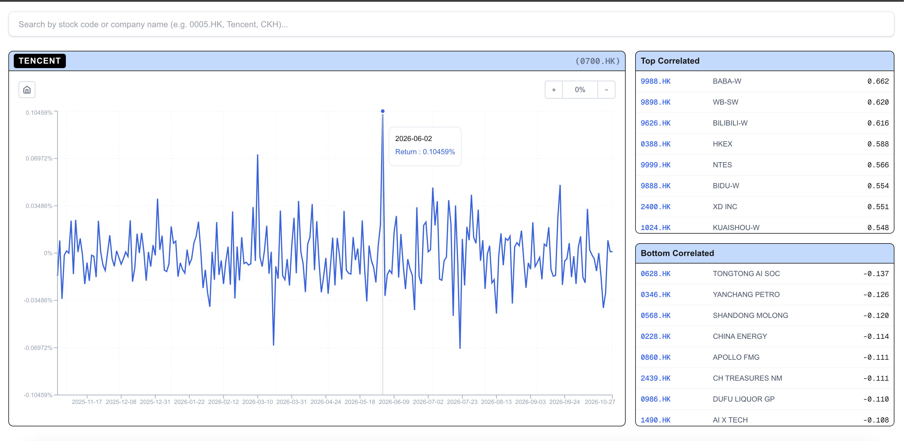

# HKEX Stock Board

Search daily returns and price correlations across 2,450 HKEX Main Board Equities. All data is sourced from Yahoo Finance.

* **Normalized Daily Returns:** Search by ticker or company name to view historical daily return percentage charts.
* **Correlation Ranking:** Automatically identify the top 10 most positively and negatively correlated stocks according to Pearson correlation coefficient.

Link to app: [https://hkex-stocks-analysis.vercel.app/](https://hkex-stocks-analysis.vercel.app/)

## Disclaimer

**For Informational Purposes Only:** The data, charts, and correlation metrics presented on this dashboard are provided strictly for informational and educational purposes. Nothing on this site constitutes financial, investment, trading, or legal advice, nor does it represent a recommendation or solicitation to buy, sell, or hold any security. 

**No Guarantee of Accuracy:** Market data is sourced from third-party providers and is provided "as is" without warranty of any kind. Data may be delayed, incomplete, or contain errors. Users should independently verify all information before making any financial decisions. Past performance and historical correlations are not indicative of future results.

**No Affiliation:** This is an independent project and is not affiliated with, endorsed by, or sponsored by Hong Kong Exchanges and Clearing Limited (HKEX) or Yahoo Finance.